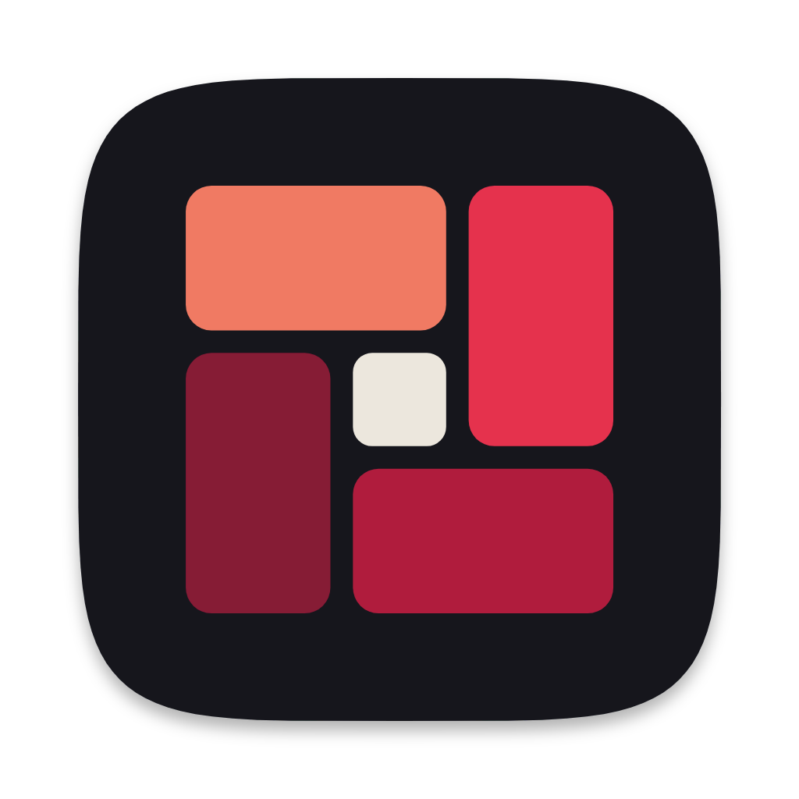

# Tilework app icon



A pinwheel of four blades around one core. The blades stand for the four
backends (`:cpu` / `:metal` / `:cuda` / `:hip`) and the ivory core for the
single codebase they run. The blades are one ruby family stepping darker
clockwise from the top, which is what makes the figure read as rotating.

An earlier version used four separate hues (red / yellow / teal / blue). It
read too close to Slack's logo, so the hues were collapsed into one ruby ramp
— that also ties the mark to Ruby — while keeping the geometry.

## Files

| File | Use |
|---|---|
| `tilework-icon-ios.{svg,png}` | iOS / iPadOS, default appearance. Full-bleed square; the system applies the mask. |
| `tilework-icon-ios-dark.{svg,png}` | iOS dark appearance. |
| `tilework-icon-ios-tinted.{svg,png}` | iOS tinted appearance (grayscale; the system applies the tint). |
| `tilework-icon-macos.{svg,png}` | macOS. 824 px body on a 1024 px canvas, outline and shadow baked in. |
| `layers/blades.*`, `layers/core.*` | Transparent layers for Icon Composer. The background is a solid Ink fill set there. |

Not yet verified against Apple's current asset requirements: whether the dark
and tinted variants should ship with an opaque or a transparent background,
and how closely the n = 5 superellipse used for the macOS outline matches
Apple's template. Check both in Xcode / Icon Composer before release.

## Palette

| Token | Hex | Role |
|---|---|---|
| Ink | `#15171D` | Background |
| Coral | `#F07A63` | Top blade (lightest) |
| Ruby | `#E5304E` | Right blade; the brand's reference color |
| Crimson | `#B01E3E` | Bottom blade |
| Wine | `#861A36` | Left blade (darkest) |
| Ivory | `#ECE7DD` | Core |

## Geometry (on the 1024 px canvas)

| | |
|---|---|
| Artwork bounds | 172 – 852 (681 px, 66.5%) |
| Blade | 415 × 230, corner radius 41 |
| Gap between blades | 36 |
| Core | 148 × 148, corner radius 31 |
| macOS body | 824 × 824, 100 px margin |

## Regenerating

`generate.py` holds every value above and is the source of truth; the SVGs
are its output and the PNGs are rasterized from them.

```
python3 brand/icon/generate.py        # writes the SVGs
node brand/icon/render_png.js         # writes a 1024 px PNG next to each SVG (needs Playwright)
```
